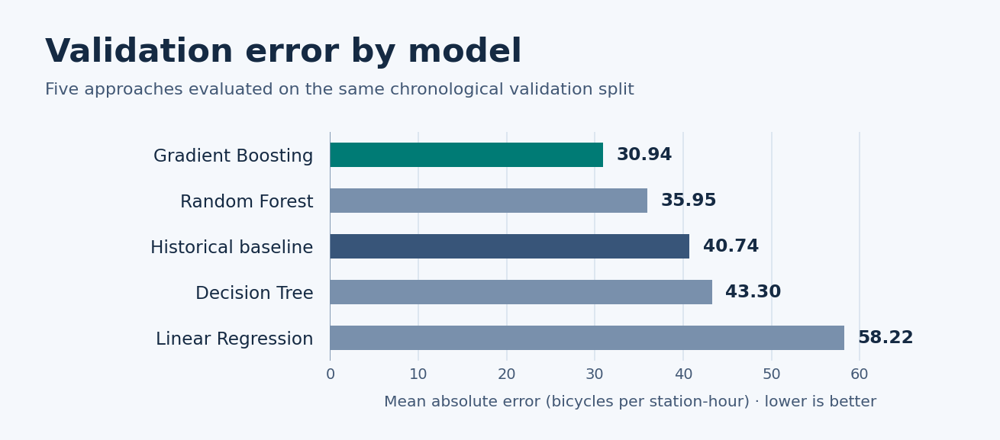
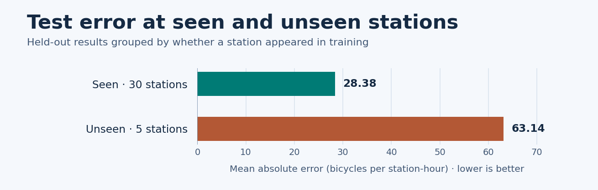
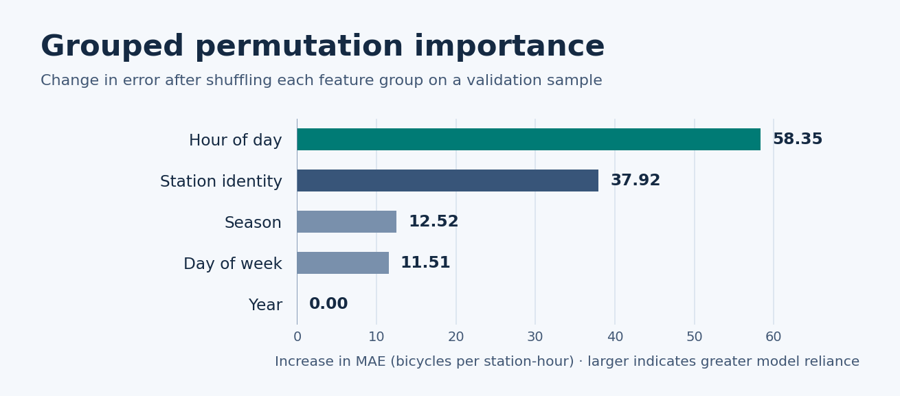

# Berlin Mobility AI

Machine learning for **hourly bicycle traffic forecasting** at Berlin’s automated counting stations. The project uses 2,216,184 hourly observations across 35 station IDs from 2017 to 2025 to evaluate how well a model trained on historical counts predicts future traffic.

| Best model | Validation improvement | Held-out test MAE | Held-out test R² |
| --- | ---: | ---: | ---: |
| Histogram-based Gradient Boosting | 24.1% lower MAE vs. baseline | 33.24 bicycles per station-hour | 0.7295 |

[Explore the notebooks](notebooks/) · [Reproduce the workflow](#reproduce-the-workflow) · [Berlin Open Data](https://daten.berlin.de/datensaetze/radzahldaten-in-berlin)

## Model performance

Histogram-based Gradient Boosting had the lowest validation MAE among the five approaches evaluated. It reduced the baseline error from **40.74** to **30.94** bicycles per station-hour.



| Model | Validation MAE ↓ | Validation RMSE ↓ | Validation R² ↑ |
| --- | ---: | ---: | ---: |
| Historical-average baseline | 40.74 | 68.64 | 0.6654 |
| Linear Regression | 58.22 | 86.04 | 0.4742 |
| Decision Tree | 43.30 | 74.33 | 0.6076 |
| Random Forest | 35.95 | 64.17 | 0.7075 |
| **Histogram-based Gradient Boosting** | **30.94** | **53.03** | **0.8003** |

The selected model recorded a **held-out test MAE of 33.24**, an **RMSE of 57.95**, and an **R² of 0.7295**. MAE and RMSE are measured in bicycles per station-hour.

### Performance at new counting stations

Test MAE was **2.22 times as high** at stations absent from training. This matters when using the model at newly installed counters, where it has no station-specific history.



| Test group | Stations | Observations | RMSE | WAPE |
| --- | ---: | ---: | ---: | ---: |
| Seen during training | 30 | 352,779 | 50.04 | 29.76% |
| Unseen during training | 5 | 57,299 | 92.84 | 90.52% |

### Which features matter?

Shuffling the **hour-of-day** feature group increased MAE the most on the validation sample, followed by **station identity**. The unshuffled sample MAE was 31.38 bicycles per station-hour.



## Data and evaluation

The source is the Berlin Senate’s hourly bicycle count dataset, *Radzähldaten in Berlin*. The pipeline combines annual Excel sheets, examines missing values and unusual counts, and uses the 2017–2025 observations for modeling. The target is the number of bicycles counted at a station in one hour. [Source data and download](https://daten.berlin.de/datensaetze/radzahldaten-in-berlin)

- **Features** — Calendar variables, cyclical encodings for hour, weekday and month, and one-hot encoding for station identity.
- **Baseline** — Mean count by station, weekday and hour, with fallbacks to the weekday-hour mean and then the global training mean.
- **Model selection** — Candidates were compared on a later validation period. The test period was reserved for final evaluation.

| Split | Period | Observations |
| --- | --- | ---: |
| Training | Jan 2017 – Apr 2023 | 1,426,327 |
| Validation | Apr 2023 – Aug 2024 | 379,779 |
| Held-out test | Aug 2024 – Dec 2025 | 410,078 |

## Reproduce the workflow

Clone the repository and install the dependencies in your Python environment.

```bash
git clone https://github.com/Hussein295/Berlin-Mobility-AI.git
cd Berlin-Mobility-AI
python -m pip install -r requirements.txt
```

1. Download the Excel workbook from [Berlin Open Data](https://daten.berlin.de/datensaetze/radzahldaten-in-berlin). Set the preprocessing script’s input path to the downloaded workbook and run preprocessing to generate the initial data files. [Preprocessing script](src/preprocess.py)
2. Open the project in VS Code or Jupyter and select the Python environment where you installed the dependencies. Run the notebooks in order.

   | Notebook | Purpose |
   | --- | --- |
   | [Exploratory analysis](notebooks/01_exploratory_analysis.ipynb) | Inspect coverage, missingness and traffic patterns |
   | [Feature engineering](notebooks/02_feature_engineering.ipynb) | Build features and create chronological splits |
   | [Modeling and evaluation](notebooks/machine_learning.ipynb) | Train, compare and evaluate forecasting models |

The modeling notebook expects `train.parquet`, `validation.parquet` and `test.parquet` in `data/processed/`. The repository tracks the code and figures. Generate data files locally and update file paths in the scripts or notebook setup cells to match your environment.

## Project status

Model development and evaluation are complete. The next milestone is an interactive forecasting app. Improving performance at new stations is a separate modeling priority that can be evaluated using station-level holdouts.
